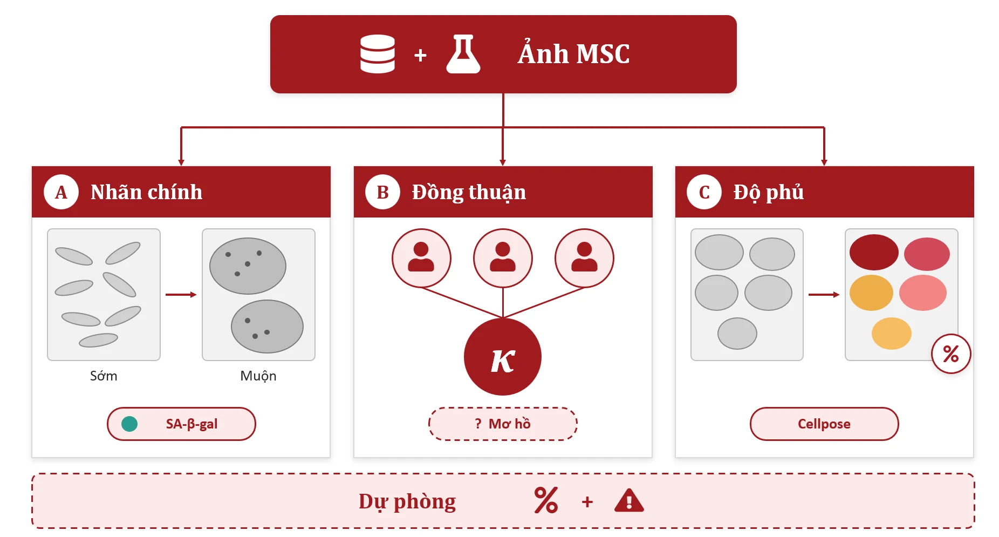
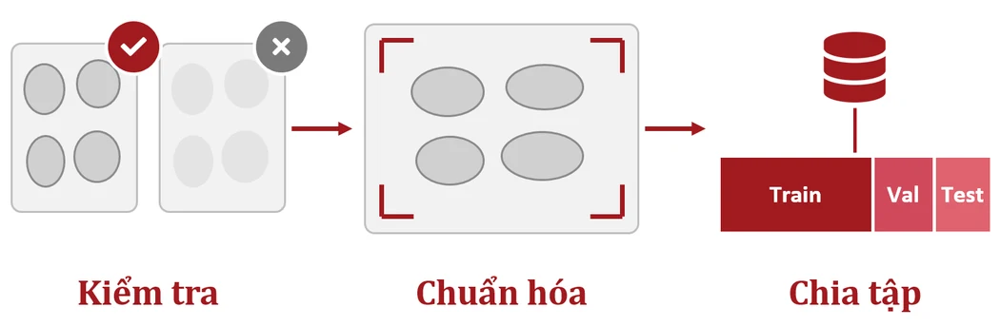
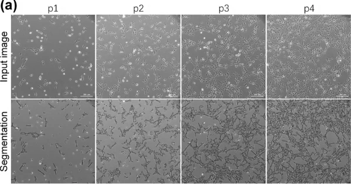
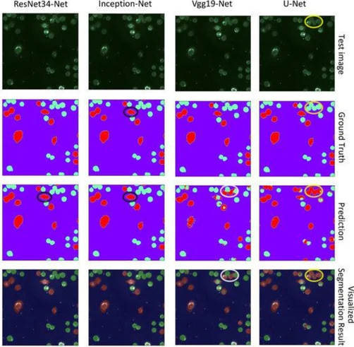

<div align="center">

# Vision-MSC

**AI đánh giá độ phủ và lão hóa tế bào gốc trung mô từ ảnh kính hiển vi**

*Tự động hóa phân tích hình ảnh — hướng tới nuôi cấy an toàn và hiệu quả*

Đội **NexusAI** · Mã đề tài **515** · Cuộc thi Sáng tạo Tế bào gốc 2026 (lần thứ 11) · Chủ đề: Tế bào gốc &amp; AI


</div>

---

## Mục lục

1. [Tóm tắt](#tóm-tắt)
2. [Đặt vấn đề](#đặt-vấn-đề)
3. [Mục tiêu](#mục-tiêu)
4. [Dữ liệu và ba bậc nhãn](#dữ-liệu-và-ba-bậc-nhãn)
5. [Phương pháp](#phương-pháp)
6. [Đánh giá](#đánh-giá)
7. [Độ tin cậy có kiểm soát](#độ-tin-cậy-có-kiểm-soát)
8. [Điểm khác biệt](#điểm-khác-biệt)
9. [Kết quả hướng tới và tác động](#kết-quả-hướng-tới-và-tác-động)
10. [Phạm vi và hướng tiếp theo](#phạm-vi-và-hướng-tiếp-theo)
11. [Trang giới thiệu](#trang-giới-thiệu)
12. [Cấu trúc thư mục](#cấu-trúc-thư-mục)
13. [Tài liệu tham khảo](#tài-liệu-tham-khảo)

---

## Tóm tắt

Tế bào gốc trung mô (MSC) có tiềm năng lớn trong y học tái tạo, nhưng việc đánh giá chất lượng nuôi cấy vẫn dựa nhiều vào quan sát bằng mắt. **Vision-MSC** là công cụ trí tuệ nhân tạo phân tích ảnh kính hiển vi **trường sáng** và **tương phản pha** để:

- **Ước tính độ phủ** (confluency) của tế bào trên đĩa nuôi cấy.
- **Đánh giá hình thái liên quan đến lão hóa** dưới dạng điểm số liên tục.
- **Phát hiện hình thái bất thường.**

Quy trình kết hợp học máy, học sâu và **hiệu chỉnh độ tin cậy**: mô hình cho biết nó chắc chắn đến đâu, và tự động chuyển các ảnh khó cho chuyên gia xem.

## Đặt vấn đề

| Hiện trạng | Hệ quả |
|---|---|
| Kỹ thuật viên ước lượng độ phủ và nhận biết tế bào lão hóa (to, dẹt, nhiều hạt) bằng mắt | Kết quả phụ thuộc kinh nghiệm từng người |
| Không có thước đo chung giữa các lô và các phòng lab | Khó chuẩn hóa, khó so sánh |
| Hệ thống chụp và phân tích tự động của hãng thiết bị | Đắt, gắn với phần cứng riêng, ít lab trong nước có |

Một công cụ AI **không xâm lấn**, chạy trên **kính hiển vi phổ thông** sẵn có tại các phòng lab Việt Nam giúp tự động hóa khâu kiểm soát chất lượng, tối ưu chi phí và bảo đảm tính khách quan.

## Mục tiêu

Xây dựng công cụ AI phân tích ảnh MSC để đánh giá **độ phủ tế bào**, **mức độ lão hóa** và **phát hiện bất thường**, đồng thời cung cấp kết quả đáng tin cậy và dễ ứng dụng trong thực tế.

## Dữ liệu và ba bậc nhãn

**Nguồn ảnh:** ảnh phase-contrast/brightfield MSC công khai (Cell Tracking Challenge, BBBC, Zenodo, Figshare, Kaggle) và ảnh thật từ ít nhất một phòng lab Việt Nam. Mỗi nguồn được kiểm tra **giấy phép, dòng tế bào, độ phóng đại và nguồn gốc nhãn** trước khi đưa vào sử dụng.

Nhãn được xây dựng theo ba bậc, ưu tiên từ đáng tin cậy nhất:

| Bậc | Loại nhãn | Cách xây dựng |
|---|---|---|
| **A** | Nhãn chính | Thông tin passage (sớm/muộn) hoặc xác nhận hoạt tính **SA-β-gal**. Passage là chỉ dấu nhanh, SA-β-gal dùng để xác nhận. |
| **B** | Đồng thuận chuyên gia | Tập con chọn ngẫu nhiên, 2–3 chuyên gia gán nhãn độc lập, đo đồng thuận bằng **Cohen’s κ / Fleiss’ κ**. Ca mơ hồ được giữ lại để phân tích riêng. |
| **C** | Độ phủ | Phân đoạn tham chiếu bằng **Cellpose**, kiểm tra thủ công trên một tập con. |

**Linh hoạt theo dữ liệu:** ngay cả khi nhãn lão hóa còn ít, hệ thống vẫn cung cấp **độ phủ + phát hiện hình thái bất thường** (anomaly detection), hai đầu ra dùng được ngay cho phòng lab.

<p align="center"></p>
<p align="center"><sub><b>Hình 1.</b> Quy trình dữ liệu và gán nhãn theo ba nhóm A–B–C.</sub></p>

## Phương pháp

Quy trình gồm 6 bước:

### 1. Thu thập dữ liệu
Thu thập ảnh MSC và xây dựng nhãn tham chiếu, phân biệt nhóm đối chứng với nhóm có dấu hiệu lão hóa.

### 2. Tiền xử lý
Kiểm tra chất lượng ảnh, chuẩn hóa và chia tập. **Chống rò rỉ dữ liệu:** chia theo thí nghiệm / đĩa nuôi cấy / nguồn dữ liệu, dùng group k-fold, chạy nhiều seed và báo cáo **trung bình ± SD**.

<p align="center"></p>

### 3. Xây dựng mô hình
Hai đầu ra:
- **Điểm lão hóa** dạng hồi quy/ordinal, thay vì ba lớp cứng.
- **Ước lượng độ phủ.**

Các mô hình được so sánh theo độ phức tạp tăng dần:

```
Đặc trưng hình thái + XGBoost  →  ResNet50  →  EfficientNet  →  ViT nhỏ
         (baseline)
```

Baseline đặc trưng hình thái giúp chọn ra mô hình thật sự hiệu quả nhất cho bài toán.

<p align="center"></p>
<p align="center"><sub><b>Hình 3.</b> Ảnh MSC đầu vào và kết quả phân đoạn tế bào tại các passage P1–P4.</sub></p>

### 4. Đánh giá mô hình
So sánh hiệu năng và kiểm tra khả năng tổng quát hóa (chi tiết ở mục [Đánh giá](#đánh-giá)).

<p align="center"></p>
<p align="center"><sub><b>Hình 4.</b> So sánh kết quả phân đoạn giữa các mô hình AI với nhãn chuẩn.</sub></p>

### 5. Giải thích có kiểm chứng
- **Grad-CAM kèm sanity check** (so với khi randomize trọng số) để bảo đảm vùng mô hình chú ý thật sự nằm trên tế bào.
- Phân tích có hệ thống các ca dự đoán sai.
- **Ablation:** bỏ augmentation, bỏ xử lý mất cân bằng, thay đổi độ phân giải ảnh.

### 6. Demo web
Công cụ gọn, mã nguồn mở, chạy với ảnh kính hiển vi thông thường. Hạ tầng: Google Colab và mô hình pretrained, không cần thiết bị đắt tiền.

## Đánh giá

| Nhóm | Chỉ số |
|---|---|
| Phân loại / ordinal (lão hóa) | macro-F1, **QWK**, ROC-AUC, confusion matrix |
| Hồi quy (độ phủ) | **MAE** |
| Hiệu chỉnh xác suất | **ECE** (Expected Calibration Error), reliability diagram |
| Cơ chế từ chối | Đường cong **risk–coverage** |

**Leave-one-dataset-out:** huấn luyện trên các nguồn còn lại, kiểm tra trên một nguồn mô hình chưa từng thấy, lần lượt với từng nguồn. Cách đánh giá này phản ánh đúng hiệu năng khi đưa công cụ sang một phòng lab mới. Ảnh từ lab Việt Nam luôn được giữ riêng để kiểm chứng ngoài.

## Độ tin cậy có kiểm soát

Vision-MSC không chỉ đưa ra dự đoán mà còn cho biết **mức độ chắc chắn**:

1. **Hiệu chỉnh xác suất (calibration):** xác suất mô hình đưa ra khớp với độ chính xác thực tế, đo bằng ECE.
2. **Ngưỡng từ chối:** ảnh nằm ngoài phân phối hoặc có độ tin cậy dưới ngưỡng τ được tự động chuyển cho chuyên gia. Ngưỡng cảnh báo do chuyên gia xác nhận.

Với một công cụ kiểm soát chất lượng, khả năng từ chối đúng lúc quan trọng không kém độ chính xác.

## Điểm khác biệt

| | Điểm khác biệt | Nội dung |
|---|---|---|
| 01 | **Benchmark độ bền khi đổi điều kiện** | Leave-one-dataset-out, kiểm tra trên nguồn dữ liệu chưa từng thấy |
| 02 | **Tự nhận biết ca khó** | Hiệu chỉnh xác suất và cơ chế từ chối dự đoán |
| 03 | **Kiểm chứng tại lab Việt Nam** | Ảnh thật từ phòng lab trong nước, ngưỡng cảnh báo do chuyên gia xác nhận |
| 04 | **Gọn, mở, dễ dùng** | Mã nguồn mở, chạy với ảnh kính hiển vi thông thường, kèm demo web |

## Kết quả hướng tới và tác động

**Kết quả hướng tới**
- **Tăng độ chính xác** trong đánh giá độ phủ tế bào và mức độ lão hóa MSC.
- **Tăng độ tin cậy** nhờ hiệu chỉnh xác suất và cơ chế từ chối dự đoán.
- **Tiết kiệm thời gian** nhờ tự động hóa phân tích hình ảnh.

**Tác động trực tiếp**
- Giảm sai lệch giữa các kỹ thuật viên.
- Ghi nhận trạng thái nuôi cấy một cách nhất quán.
- Giảm lãng phí vật tư khi tế bào đã lão hóa nhưng vẫn bị dùng tiếp.

**Hướng phát triển**
- Nền tảng cho kiểm soát chất lượng các sản phẩm từ MSC, trong đó có liệu pháp tái tạo da.
- Mở rộng sang đánh giá chất lượng exosome từ MSC.

## Phạm vi và hướng tiếp theo

- Giai đoạn này tập trung vào **tình trạng tế bào MSC**; đánh giá chất lượng exosome là bước mở rộng tiếp theo.
- Nhãn lão hóa dựa trên passage và SA-β-gal, được củng cố thêm bằng **đồng thuận chuyên gia**.
- Kiểm chứng trên ảnh từ **phòng lab Việt Nam** để hiệu chỉnh ngưỡng theo điều kiện trong nước.
- Đồng hành cùng chuyên gia: giúp kỹ thuật viên ra quyết định **nhanh và nhất quán** hơn; quyết định cuối thuộc về chuyên gia.

## Trang giới thiệu

Thư mục [`site/`](site) chứa trang web giới thiệu dự án: HTML/CSS/JS tĩnh, không cần bước build.

**Các phần tương tác**
- **Đĩa nuôi cấy 3D** (three.js): mô phỏng quá trình quét và phân đoạn tế bào, kéo để xoay.
- **Tế bào MSC 3D**: thanh trượt chuyển hình thái từ hình thoi (trẻ) sang to, dẹt, nhiều hạt (lão hóa).
- **Ảnh thật P1 → P4**: so sánh ảnh gốc với mặt nạ phân đoạn bằng thanh kéo, cắt từ Hình 3.
- **Leave-one-dataset-out**: minh họa lần lượt từng nguồn dữ liệu được giữ riêng để kiểm tra.
- **Pipeline 6 bước** sáng dần theo cuộn trang.
- **Reliability diagram trước/sau hiệu chỉnh** và **demo ngưỡng từ chối risk–coverage** (số liệu mô phỏng).

**Chạy trên máy**

```bash
python -m http.server 8765 -d site
```

Sau đó mở http://localhost:8765.

**Triển khai lên Netlify**

File [`netlify.toml`](netlify.toml) đã cấu hình sẵn thư mục publish là `site`. Vào Netlify, chọn **Add new site → Import from GitHub**, rồi chọn repo này. Mỗi lần push lên nhánh `main`, trang sẽ tự cập nhật.

**Công nghệ:** IBM Plex Sans/Mono (Google Fonts), three.js 0.160 (qua CDN jsdelivr), SVG vẽ tay cho biểu đồ, ảnh WebP.

## Cấu trúc thư mục

```
.
├── netlify.toml            # Cấu hình Netlify (publish thư mục site/)
├── README.md
└── site/
    ├── index.html          # Nội dung trang
    ├── style.css           # Giao diện
    ├── main.js             # Tương tác 2D: so sánh ảnh, biểu đồ, pipeline
    ├── scene3d.js          # Hai cảnh 3D (three.js)
    └── assets/
        ├── fig*.webp       # Hình 1–4 từ poster
        ├── p1..p4-in.webp  # Ảnh tương phản pha tại passage P1–P4
        └── p1..p4-mask.webp# Mặt nạ phân đoạn tương ứng
```

## Tài liệu tham khảo

1. He, L., Li, M., Wang, X., et al. (2024). Morphology-based deep learning enables accurate detection of senescence in mesenchymal stem cell cultures. *BMC Biology*, 22, 1. https://doi.org/10.1186/s12915-023-01780-2
2. Liu, Z., An, G., Liang, X., et al. (2026). Deep learning-based in silico labeling for analyzing morphological features of MSCs to predict immunomodulatory capacity. *Communications Biology*, 9, 742. https://doi.org/10.1038/s42003-026-09833-2
3. Dawood, T., Chen, C., Sidhu, B. S., et al. (2023). Uncertainty aware training to improve deep learning model calibration for classification of cardiac MR images. *Medical Image Analysis*, 88, 102861. https://doi.org/10.1016/j.media.2023.102861
4. Mukherjee, S., Sarkar, R., Manich, M., Labruyere, E., & Olivo-Marin, J.-C. (2023). Domain adapted multitask learning for segmenting amoeboid cells in microscopy. *IEEE Transactions on Medical Imaging*, 42(1), 42–54. https://doi.org/10.1109/TMI.2022.3203022

---

<div align="center">
<sub>Đội NexusAI · MĐT 515 · Cuộc thi Sáng tạo Tế bào gốc 2026 · <a href="https://2026.stemcellinnovation.com.vn">2026.stemcellinnovation.com.vn</a></sub>
</div>
